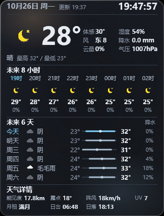

# WeatherPanel · 桌面天气面板

Windows 桌面常驻天气组件。贴在屏幕右上角，深色金属玻璃材质，不抢焦点、不进 Alt+Tab、鼠标穿透 —— 桌面空闲时清晰可见，打开其它程序时会被正常盖住。

  



## 功能

- **实时时钟**，秒级刷新
- **当前天气**：温度（大号）、天气现象、24 个手绘风天气图标（昼夜自动切换）
- **当前六项指标**：体感温度、湿度、风向风速、降水量、云量、气压
- **未来 8 小时**：时间 / 图标 / 温度 / 降水概率
- **未来 6 天**：星期 / 图标 / 天气 / 最低~最高温（带温度条）/ 降水概率
- **天气详情**：能见度、露点、阵风、UV 指数、月相、日出日落
- **自动刷新**：每 30 分钟一次
- **断网容错**：
  - 启动阶段激进重试（开机往往还没联网）：5 秒一次连续 30 次，之后 10 秒起每轮 +5 秒再 30 次
  - 运行中断网：10 秒一次连续 30 次
  - 次数用完则停止轮询，改为监听系统网络事件，联网瞬间自动恢复
  - 失败期间面板盖上「网络超时」提示，联网并取到数据后自动消失
- **常驻桌面**：普通窗口层，打开的程序可覆盖它；不抢焦点、不进 Alt+Tab、鼠标穿透
- **单实例**运行，重复启动不会多开
- 随系统 DPI 缩放，支持高对比度与深色桌面

## 数据来源

| 数据 | 来源 |
| --- | --- |
| 实况：温度 / 天气现象 / 湿度 / 气压 / 能见度 / 降水量 / 风向风速 | 中国天气网 |
| 未来 6 天温度 | 中国天气网 |
| 未来 6 天天气现象 | 中国天气网（7 天预报页面） |
| 体感 / 露点 / 阵风 / UV / 云量 / 逐小时 / 降水概率 / 日出日落 | Open-Meteo |

两个来源并行拉取、互补合并：任一来源失败会自动降级到另一来源，面板不会空白；日志中会记录实际使用的来源组合。

> 中国天气网的 `d1.weather.com.cn` 是其站点页面内部使用的接口（需要 Referer 头），并非对外承诺的公开 API，站点改版后可能失效。逐小时预报与降水概率该接口不提供，由 Open-Meteo 补齐。

**更换城市**：修改 `src/Weather.cs` 顶部的 `Lat` / `Lon`（Open-Meteo 坐标）与 `CnCityCode`（中国天气网城市码，可在其站点查询）。

## 系统要求

- Windows 10 / 11，x64 架构
- **安装版已内置 .NET 8 运行时**，目标电脑无需安装任何组件，也不联网下载
- 从源码构建需要 .NET 8 SDK

## 安装

从 [Releases](../../releases) 下载 `WeatherPanel-Setup-x.y.z.exe`，双击按向导安装即可。

- 用户级安装，默认路径 `%LOCALAPPDATA%\Programs\WeatherPanel`，**不需要管理员权限**
- 安装路径可自行更改
- 可选勾选：创建桌面快捷方式、开机自动启动
- 卸载：设置 → 应用 → 已安装的应用 → WeatherPanel 桌面天气面板 → 卸载
  （卸载会一并清理程序文件、快捷方式与开机启动项）

## 从源码构建

```bash
# 普通发布（依赖本机已安装 .NET 8 运行时）
dotnet publish src -c Release -o publish

# 自带运行时（可分发到未装 .NET 的电脑）
dotnet publish src -c Release -r win-x64 --self-contained true \
    -p:PublishReadyToRun=true -o dist
```

生成安装包（Windows）：

```
setup\build.cmd
```

依赖：.NET 8 SDK、WiX 4（`dotnet tool install -g wix`）、Inno Setup 6。
脚本会依次完成发布、组装安装内容、生成 MSI 与带图标的 EXE 安装包。

## 目录结构

```
src/                 WPF 工程（.NET 8 / Windows）
  Weather.cs         双源数据抓取、解析与合并
  MainWindow.xaml    界面布局
  MainWindow.xaml.cs 窗口生命周期、渲染与刷新调度
  Native.cs          窗口层级与 Win32 调用
  Log.cs             生命周期与异常日志
  MetalMaterial.cs   噪点材质
  Themes/Metal.xaml  配色与材质定义
  Assets/weather/    24 个天气图标
setup/               安装包构建脚本
  build.cmd          一键打包
  app.iss            Inno Setup 安装定义
  gen_wxs.py         生成 WiX 安装清单
```

## 运行日志

位于 `%LOCALAPPDATA%\WeatherPanel\Logs\`：

- `lifecycle.log` —— 启动、窗口状态、数据刷新、断网重试
- `fetch.log` —— 数据抓取失败详情
- `crash.log` —— 未处理异常

## 已知限制

- 中国天气网接口为页面内部接口，非公开 API，可能随时变更
- 该接口不提供降水概率与逐小时预报，这两项来自 Open-Meteo
- 中国天气网的 JSON 预报只覆盖 5 天，第 6 天温度来自 Open-Meteo
- 面板为鼠标穿透设计、不提供关闭按钮，退出请在任务管理器结束 `WeatherPanel.exe`

## 许可

[MIT](LICENSE)
